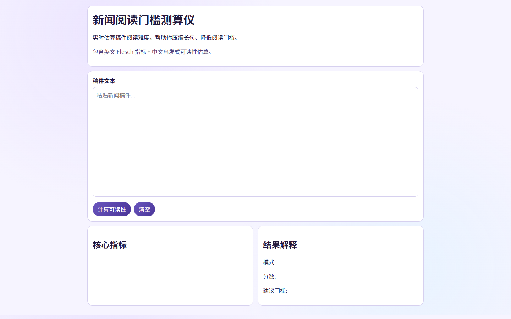

# P05 新闻阅读门槛测算仪

## 用途

实时计算稿件可读性，帮助减少长句和复杂表达。

## 使用

1. 粘贴文本。
2. 也可从“真实新闻示例（改写版）”中一键载入。
3. 点击“计算可读性”。
4. 查看核心指标与建议门槛。

## 指标

- 英文文本: Flesch Reading Ease。
- 中文文本: 启发式可读性估算（句长+生僻字比率）。

## 真实新闻示例（内置）

- WHO（2024-08-14）猴痘疫情公共卫生紧急事件：
  https://www.who.int/news/item/14-08-2024-who-director-general-declares-mpox-outbreak-a-public-health-emergency-of-international-concern
- Boeing（2024-06-06）星际客机首次载人试飞：
  https://www.boeing.com/space/starliner/first-crewed-flight-test/
- UN Climate Change（2023-12-13）COP28 阿联酋共识：
  https://unfccc.int/news/cop28-agreement-signals-beginning-of-the-end-of-the-fossil-fuel-era
- AP（2024-03-26）巴尔的摩大桥坍塌事件专题：
  https://apnews.com/hub/key-bridge-collapse

说明：页面内示例文本为“基于真实报道事实的改写版”，用于可读性测试，不是原文全文转载。

## 隐私

- 全本地计算，无后端上传。


## 已知限制

- 仅支持现代 Chromium 内核浏览器 (Chrome 110+, Edge 110+)。
- 中文分词精度有限。
- 本工具为前端纯静态实现，不含后端服务。
## 产品化优化（PM）

### 优化目标
- 降低新用户上手门槛，并提升首轮输出质量稳定性。

### 目标用户
- 一线用户：希望在 3 分钟内完成核心任务的内容/数据/核查从业者。
- 管理者：关注输出质量稳定性、效率提升和可复用流程。

### 核心使用场景
- 采访前快速生成对比草稿
- 编辑复核口径偏差与幻觉
- 形成可复制的报道工作流

### 北极星指标（上线后 2 周）
- 首次任务完成率 >= 70%
- 核心任务完成时长 P50 <= 3 分钟
- 7 日回访率 >= 20%

### 下一步迭代（按优先级）
1. 新增默认示例与一键体验路径
2. 加入输出质量评分与纠错建议
3. 提供多模板导出（稿件/提纲）

## 数据化追踪（PM）

### 已接入埋点事件
- `page_view`：页面访问
- `first_interaction`：首次交互时延
- `cta_click`：核心按钮点击
- `task_start` / `task_complete` / `task_error`：核心任务生命周期
- `status_success_signal` / `status_error_signal`：状态文本成功/失败信号
- `page_hidden` / `page_unload`：页面停留与离开

### 看板字段（统一）
- `project_id`（例如：P05-flesch-meter）
- `project_cluster`
- `session_id`
- `event_name`
- `event_time`
- `page_path`
- `control_id`
- `task_name`（当前项目默认：content_generation_core_task）
- `task_duration_ms`
- `elapsed_ms`
- `status_text`

### 本地查看与导出
在浏览器控制台执行：

```js
window.pmMetrics.getSummary()
window.pmMetrics.exportEvents()
```

### 上线后两周目标
- 首次交互时延 P50 <= 10 秒
- 核心任务完成率 >= 70%
- 核心任务完成时长 P50 <= 180 秒

<!-- PLAYWRIGHT_REVIEW:START -->
## 页面效果截图（Playwright）

> Captured: 2026-03-02T09:19:19.915Z | Mode: headed (non-headless)



## 可改进点（自动巡检）
- 修复浏览器控制台报错，降低运行时故障和功能中断风险。

- 巡检信号：console_error=1，request_failed=0，load_ms=2896
- 页面标题：P05 新闻阅读门槛测算仪

<!-- PLAYWRIGHT_REVIEW:END -->

